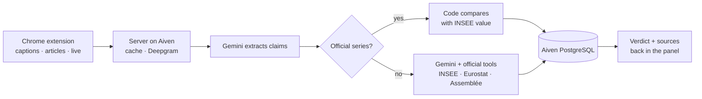

# The data layer in action

**What data.** What politicians say: YouTube captions and press articles read in the browser, or audio (videos without captions, TikTok, Reels, X, radio podcasts) transcribed by Deepgram. What is true: official producers only. 40 official series frozen from INSEE, Eurostat and the Interior ministry (employment, inflation, growth, minimum wage, public debt and deficit, asylum and residence permits, recorded crime), compared in code, plus live tools the model calls itself: the full INSEE catalogue, Eurostat, World Bank, data.gouv.fr (certified public producers only), INSEE publications, pages of official sites (closed list) and Assemblée nationale votes. No Wikipedia, blogs or social networks as evidence.

**Where it lives.** Aiven PostgreSQL stores every speech, transcript, claim and verification (verdict, official value, sources), which builds a reliability profile per politician. The engine runs on Aiven Runtime next to the database; a cache avoids re-analysing a page; the user's history stays in the browser.

**How it flows.**

Numbers are compared in code, not by the LLM, whenever an official series exists. Every verdict links to its source.
