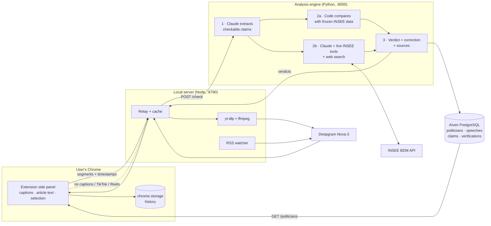

# The data layer in action

What data the agent uses, where it lives, and how it flows. Everything below describes the code on the `lot-a-extension` branch.

## 1. What data the agent uses

| Data | Source | How we get it |
|---|---|---|
| **What was said** (transcript) | YouTube captions, press articles, selected text | Read in the user's browser by the Chrome extension (YouTube transcript panel, Readability for articles) |
| | Videos without captions, TikTok, Instagram Reels, X, Facebook, Dailymotion, Vimeo, Twitch, france.tv… | Audio downloaded by `yt-dlp` + `ffmpeg` on the local server, transcribed by **Deepgram Nova-3** (French, speaker diarization, timestamps) |
| | Political radio interviews (RMC, RTL, Sud Radio) | RSS watcher (`server/feeds.json`) → MP3 URL → Deepgram; only the guest's voice is kept |
| **Official statistics, frozen** | 15 INSEE / DARES series on employment and unemployment | `scripts/fetch_insee.py` pulls the INSEE BDM API (SDMX) into `data/referentiel/emploi.json`, committed to the repo |
| **Official statistics, live** | The whole INSEE BDM catalogue (229 themes: inflation, public debt, GDP, wages, poverty…) | Claude calls 3 tools at verification time (`backend/app/insee_api.py`): find a theme → list its series → read a series |
| **Everything else** | Votes, laws, other facts | Claude's server-side web search, preferring institutional sources and fact-checkers |
| **Reasoning** | Claude Sonnet 5.5 (configurable `LLM_MODEL`) | One client in `backend/app/llm.py`: extraction, wording, web/INSEE tool loop, chat |

## 2. Where it lives

| Store | Technology | Content | Lifetime |
|---|---|---|---|
| **Fact-check database** | **PostgreSQL 18 on Aiven** (`factcheck` project, service `pg-cd8988f`, Frankfurt) via `DATABASE_URL`; SQLite file as local fallback | `politicians`, `speeches` (full timestamped transcript as JSON), `claims` (quote, indicator, value, unit, period), `verifications` (verdict, method, official value, confidence, full JSON with sources) — schema `db/schema.sql` | Permanent, shared by the whole team |
| Frozen reference data | JSON in the repo | 15 official series with full history, source URL, last update | Versioned with the code |
| Analysis cache | `server/data/check-cache.json` (Node) | Response per `url + speaker`: re-opening a page costs no LLM call | Until cleared |
| Watch state | `server/data/state.json` (Node) | Podcast and channel episodes, status, verdicts | Permanent |
| Transcripts and INSEE responses | In-memory (Node: 50 transcripts; Python: 200 INSEE responses, 6 h) | Avoid paying Deepgram or calling INSEE twice | Until restart |
| User history | `chrome.storage.local` | Last 40 analysed pages with their verdicts; "this session" = until the browser closes | On the user's machine only |
| Secrets | `backend/.env`, `server/.env` (git-ignored) | Anthropic, Deepgram, Aiven URI | Never in the repo, never in the extension |

## 3. How it flows



Step by step, for a YouTube video:

1. **Capture** — the side panel detects the video and reads YouTube's own transcript in the page, with a timestamp per line. No captions, or another platform: the local server downloads the audio (`yt-dlp`) and Deepgram returns timestamped, speaker-separated text in ~20 s.
2. **Relay** — the Node server returns a cached answer if this page was already analysed; otherwise it forwards to the Python engine (`POST /check`, format in `shared/contract.ts`).
3. **Extract** — Claude reads the transcript as untrusted data and returns up to 15 structured claims: quote, timestamp, indicator, value, unit, period.
4. **Verify**, 6 claims in parallel:
   - claim matches one of the 15 frozen series → **the code** computes the gap with the official value at the right period and grades it (`referentiel.py`); Claude only writes the explanation;
   - otherwise → Claude reads the **live INSEE series** (inflation, debt, GDP…) or searches the web; confidence is capped at 0.7;
   - nothing reliable → `invérifiable`.
5. **Store** — when the speaker is known, the speech, its transcript, each claim and its verification are written to **Aiven PostgreSQL**. This feeds the per-politician reliability profile (`GET /politicians/{slug}`: verdict counts, by topic, score 0–100 after 5 claims).
6. **Show** — cards in the panel: verdict, correction, sources (official ones flagged), ▶ jump to the exact second; the claim being spoken is highlighted live. The chat answers follow-up questions with the same data and tools.

Typical timings measured on 22 Oct 2026: demo claims 7 s, a 3-minute video ~30 s, a podcast transcription 5 s, a TikTok 20 s.

## 4. Guarantees built into the data layer

- **Numbers are compared in code, not by the LLM**, whenever an official series exists in the frozen reference.
- **No verdict without a source**: web sources are kept only if the search actually returned that URL; INSEE series link to their insee.fr page.
- **Profiles only for known speakers**: nothing is stored when the speaker is unknown (a channel name is never used as a politician).
- **Untrusted inputs stay data**: transcripts are fenced in prompts; the local server only answers the extension on `localhost`; `yt-dlp` refuses local network addresses; INSEE and transcript caches are bounded.

## 5. Turning on Aiven

```bash
# backend/.env — Service URI from the Aiven console (factcheck → pg-cd8988f → Overview)
DATABASE_URL=postgres://avnadmin:…@pg-cd8988f-factcheck.j.aivencloud.com:24065/defaultdb?sslmode=require
```

Restart the engine: the four tables are created on startup and every new analysis with a known speaker lands in Aiven. Without `DATABASE_URL`, the same schema runs on a local SQLite file.
