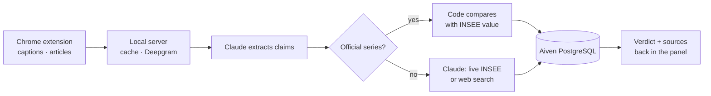

# The data layer in action

**What data.** What politicians say: YouTube captions and press articles read in the browser, or audio (videos without captions, TikTok, Reels, X, radio podcasts) transcribed by Deepgram. What is true: 15 INSEE/DARES employment series frozen from the INSEE API, the full INSEE catalogue queried live by Claude (inflation, debt, GDP…), and web search as a last resort.

**Where it lives.** Aiven PostgreSQL stores every speech, transcript, claim and verification (verdict, official value, sources), which builds a reliability profile per politician. A local cache avoids re-analysing a page; the user's history stays in the browser.

**How it flows.**

Numbers are compared in code, not by the LLM, whenever an official series exists. Every verdict links to its source.
