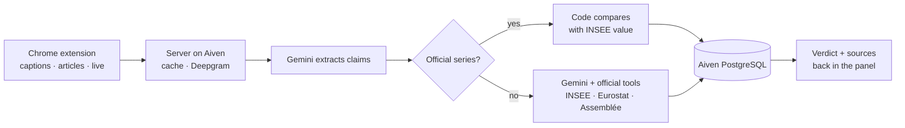

# Vérif'Pol: fact-checking French politicians against official data

A Chrome extension and an engine hosted on Aiven that check what politicians say, in videos, articles and podcasts, against official statistics, and show a verdict, a correction and the source.

## The data layer in action

**What data.** What politicians say: YouTube captions and press articles read in the browser, or audio (videos without captions, TikTok, Reels, X, radio podcasts) transcribed by Deepgram. What is true: official producers only. 40 official series frozen from INSEE, Eurostat and the Interior ministry (employment, inflation, growth, minimum wage, public debt and deficit, asylum and residence permits, recorded crime), compared in code, plus live tools the model calls itself: the full INSEE catalogue (inflation, debt, GDP…), Eurostat, World Bank, data.gouv.fr (certified public producers only), INSEE publications, pages of official sites (closed list) and every vote of the Assemblée nationale. No Wikipedia, blogs or social networks as evidence.

**Where it lives.** Aiven PostgreSQL stores every speech, transcript, claim and verification (verdict, official value, sources), which builds a reliability profile per politician (Profiles tab). The engine runs on Aiven Runtime next to the database; a cache avoids re-analysing a page; the user's history stays in the browser.

**How it flows.**

Numbers are compared in code, not by the LLM, whenever an official series exists. Every verdict links to its source.

## Evidence it works

**Benchmark against a naive baseline.** 10 political claims dated 22 October 2026, whose answer is set by the latest official INSEE / DARES figures. Baseline: the same model with no data and no tools. Run with two engines. Script: `scripts/benchmark.py`.

| Engine | Vérif'Pol | Naive baseline | Official source | Time per claim |
|---|---|---|---|---|
| Claude Sonnet 5.5 | **10/10** (9/10 before the bound fix) | 3/10 | **10/10** vs 0/10 | 14 s |
| Gemini 3.5 Flash-Lite (free tier, in production) | **10/10** | 6/10 | **10/10** vs 0/10 | 3 s |

| Claim (translated) | Truth (official figure) | Vérif'Pol | Baseline |
|---|---|---|---|
| Unemployment is 8.3% today. | **true** · 8.3% (INSEE, Q2 2026) | true ✅ | unverifiable ❌ |
| Unemployment fell to 6.5%, its lowest level. | **false** · 8.3% (INSEE, Q2 2026) | false ✅ | false ✅ |
| Since 2017, unemployment fell by more than three points. | **false** · 9.4% in 2017 → 8.3%: −1.1 points | misleading ✅ | true ❌ |
| Unemployment among under-25s is above 20%. | **true** · 21.6% (INSEE, Q2 2026) | true ✅ | false ❌ |
| The employment rate of 15-64 year-olds reaches 69%. | **true** · 69.0% (INSEE, Q2 2026) | true ✅ | true ✅ |
| There are fewer than two million category A job seekers. | **false** · 3,323,000 (DARES, Q2 2026) | false ✅ | unverifiable ❌ |
| Inflation is above 4% year on year. | **false** · 3.1% (INSEE, Sept. 2026) | false ✅ | unverifiable ❌ |
| Inflation is back above 3% year on year. | **true** · 3.1% (INSEE, Sept. 2026) | true ✅ | unverifiable ❌ |
| Public debt reaches 119% of GDP. | **true** · 119.0% (INSEE, Q2 2026) | true ✅ | false ❌ |
| Public debt is about €2,000 billion. | **false** · €3,595.5 bn (INSEE, Q2 2026) | false ✅ | false ✅ |

**What the baseline gets wrong.** Without data, the model cannot know recent figures, so it answers "unverifiable" on inflation and job seekers, and its memory is out of date: it accepts "unemployment fell by more than 3 points since 2017" (the real drop is 1.1 points). Vérif'Pol reads the official series and compares the numbers in code.

**Before / after.** The first run scored 9/10: "under-25 unemployment is above 20%" was judged false because the comparator ignored "more than / less than". We added a floor/ceiling field to extraction and to the comparison code; the second run scored 10/10.

**Limits.** A 10-claim set built by the team: a demonstration, not a statistical evaluation. The benchmark covers employment, inflation and debt; the frozen reference now also covers growth, the minimum wage and the deficit. Other topics rely on live official data, with confidence capped at 0.7.
