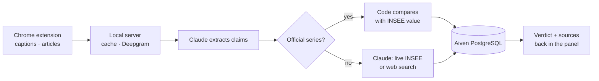

# Vérif'Pol: fact-checking French politicians against official data

A Chrome extension and a local engine that check what politicians say, in videos, articles and podcasts, against official statistics, and show a verdict, a correction and the source.

## The data layer in action

**What data.** What politicians say: YouTube captions and press articles read in the browser, or audio (videos without captions, TikTok, Reels, X, radio podcasts) transcribed by Deepgram. What is true: 15 INSEE/DARES employment series frozen from the INSEE API, the full INSEE catalogue queried live by Claude (inflation, debt, GDP…), and web search as a last resort.

**Where it lives.** Aiven PostgreSQL stores every speech, transcript, claim and verification (verdict, official value, sources), which builds a reliability profile per politician. A local cache avoids re-analysing a page; the user's history stays in the browser.

**How it flows.**

Numbers are compared in code, not by the LLM, whenever an official series exists. Every verdict links to its source.

## Evidence it works

**Benchmark against a naive baseline.** 10 political claims dated 22 October 2026, whose answer is set by the latest official INSEE / DARES figures. Baseline: the same model (Claude Sonnet 5.5) with no data and no tools. Script: `scripts/benchmark.py`.

| | Vérif'Pol | Naive baseline |
|---|---|---|
| Correct verdicts | **10/10** | 3/10 |
| Verdicts backed by an official source | **10/10** | 0/10 |
| Before / after the bound fix | 9/10 → **10/10** | — |
| Average time per claim | 14 s | 2 s |

| Claim (translated) | Truth (official figure) | Vérif'Pol | Baseline |
|---|---|---|---|
| Unemployment is 8.3% today. | **true** · 8.3% (INSEE, Q2 2026) | true ✅ | unverifiable ❌ |
| Unemployment fell to 6.5%, its lowest level. | **false** · 8.3% (INSEE, Q2 2026) | false ✅ | false ✅ |
| Since 2017, unemployment fell by more than three points. | **false** · 9.4% in 2017 → 8.3%: −1.1 points | misleading ✅ | true ❌ |
| Unemployment among under-25s is above 20%. | **true** · 21.6% (INSEE, Q2 2026) | true ✅ | false ❌ |
| The employment rate of 15-64 year-olds reaches 69%. | **true** · 69.0% (INSEE, Q2 2026) | true ✅ | true ✅ |
| There are fewer than two million category A job seekers. | **false** · 3,323,000 (DARES, Q2 2026) | false ✅ | unverifiable ❌ |
| Inflation is above 4% year on year. | **false** · 3.1% (INSEE, Sept. 2026) | false ✅ | unverifiable ❌ |
| Inflation is back above 3% year on year. | **true** · 3.1% (INSEE, Sept. 2026) | true ✅ | unverifiable ❌ |
| Public debt reaches 119% of GDP. | **true** · 119.0% (INSEE, Q2 2026) | true ✅ | false ❌ |
| Public debt is about €2,000 billion. | **false** · €3,595.5 bn (INSEE, Q2 2026) | false ✅ | false ✅ |

**What the baseline gets wrong.** Without data, the model cannot know recent figures, so it answers "unverifiable" on inflation and job seekers, and its memory is out of date: it accepts "unemployment fell by more than 3 points since 2017" (the real drop is 1.1 points). Vérif'Pol reads the official series and compares the numbers in code.

**Before / after.** The first run scored 9/10: "under-25 unemployment is above 20%" was judged false because the comparator ignored "more than / less than". We added a floor/ceiling field to extraction and to the comparison code; the second run scored 10/10.

**Limits.** A 10-claim set built by the team: a demonstration, not a statistical evaluation. The frozen reference covers employment only; other topics rely on live INSEE data or the web, with confidence capped at 0.7.
